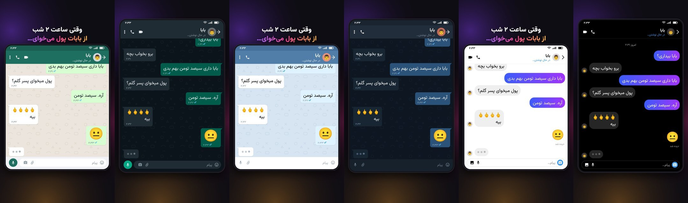

# چت‌ساز آی‌داک · AiDock Chat Maker

ساخت ویدیوی چت عمودی (۹:۱۶) برای ریلز و شورتس؛ مستقیم در مرورگر، بدون نصب و بدون اینترنت.

متن پیام‌ها و زمان‌بندی رو وارد کن، سبک چت و موزیک رو انتخاب کن و ویدیوی ۱۰۸۰×۱۹۲۰ با صدا تحویل بگیر.

## امکانات

- **سه سبک چت:** سبز، آبی و دایرکت، هر کدوم با حالت روشن و تاریک
- **زمان‌بندی دقیق:** مکث جدا برای هر پیام، با نمایش «در حال نوشتن…»
- **۱۹ افکت صوتی:** بوم، دام‌دام‌دام، جیرجیرک، تشویق، طبل، تادا و…
- **۴ افکت تصویری:** لرزش، زوم، فلش، و زوم با لرزش
- **۵ موزیک آماده‌ی بدون کپی‌رایت:** بامزه، لوفای، تعلیق، یواشکی، دراماتیک؛ فایل موزیک خودت هم قبول میشه
- **متن قلاب و کارت پایانی:** قابل خاموش و روشن کردن
- **ذخیره و بازکردن پروژه:** به‌صورت فایل JSON
- **خروجی MP4:** با صدا، مستقیم از مرورگر (کروم)
- **موبایل‌فرندلی:** روی گوشی هم کار می‌کنه

## استفاده

1. فایل `index.html` رو دانلود کن و با **کروم** باز کن.
2. پیام‌ها رو بنویس و برای هر کدوم مکث و افکت رو تنظیم کن.
3. «▶ پخش» برای پیش‌نمایش، «⏺ ساخت ویدیو» برای دانلود.

## مجوز

© ۱۴۰۵ [aidock.ir](https://aidock.ir). همه‌ی حقوق محفوظ است؛ جزئیات در [LICENSE](LICENSE).

---

**AiDock Chat Maker** is a single-file, offline browser tool for making vertical (9:16) chat-story videos for Reels and Shorts: timed messages, typing indicators, three chat styles with light and dark modes, 19 sound effects, 4 visual effects, built-in royalty-free music and MP4 export. Made by [aidock.ir](https://aidock.ir).
